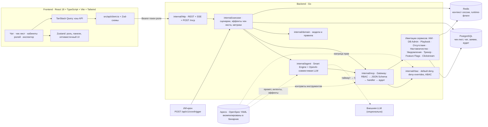
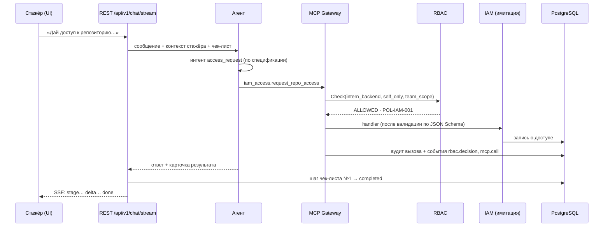

# Avito Start AI-Buddy

ИИ-наставник для стажёров: отвечает на вопросы о процессах команды с учётом контекста стажёра,
ведёт чек-лист адаптации и **выполняет действия в корпоративных сервисах через MCP** — с проверкой
прав (RBAC) на каждом вызове. Прототип для кейса Авито, Hack&Change 2026.

> **Все данные синтетические.** Сотрудники, команды, инструкции и корпоративные сервисы — имитации.
> Каждая инструкция базы знаний несёт флаг `is_synthetic: true` и дисклеймер
> «Тестовая инструкция (Синтетические данные)»; это не регламенты Авито.

## Запуск одной командой

```bash
docker compose up --build
```

| Что | Адрес |
|---|---|
| Интерфейс | http://localhost:3000 |
| REST API | http://localhost:8080/api/v1 |
| MCP (JSON-RPC 2.0) | `POST http://localhost:8080/mcp` |
| Health | http://localhost:8080/healthz |

Ключи и настройка не нужны: без LLM-ключа работает детерминированный **Smart Engine**, все три
сценария проходятся полностью. Миграции PostgreSQL и синтетические данные загружаются при старте.
Порты меняются переменными `FRONTEND_PORT` / `BACKEND_PORT` (см. [.env.example](.env.example)).

### Тестовые учётные данные

Авторизация и ролевая модель в Авито уже есть, поэтому прототип их имитирует: переключатель ролей
в шапке выбирает тестового пользователя, сервер определяет роль по токену (клиент роль передать не может).

| Роль в интерфейсе | Пользователь (синтетический) | Роль RBAC | Токен (`Authorization: Bearer …`) |
|---|---|---|---|
| Стажёр | Алексей Смирнов, команда Autoteka, Go, Week 1 | `intern_backend` | `demo-intern-token` |
| Наставник | Мария Кузнецова | `mentor` | `demo-mentor-token` |
| Руководитель | Дмитрий Орлов | `team_lead` | `demo-lead-token` |

Сервисный аккаунт ИИ-крона (`system_cron`) токена не имеет — войти под ним снаружи нельзя.

## Порядок проверки для жюри (≈5 минут)

Откройте http://localhost:3000. Под полем ввода есть кнопки-сценарии — формулировки можно не печатать.
Кнопка **«Инспектор»** в шапке показывает аудит MCP-вызовов, решения RBAC и Clickstream по каждому шагу.
**«Сбросить демо»** возвращает исходное состояние для повторного прогона.

### Сценарий 1. Доступы + проверка RBAC

| Шаг | Действие | Ожидаемый результат |
|---|---|---|
| 1А | Кнопка **«1А · Доступы»** («Дай доступ к репозиторию avito-autoteka-api и тестовому стенду») | Карточка «Доступ выдан» (репозиторий, стенд, маскированный синтетический токен, `ALLOWED · POL-IAM-001`). Шаг №1 чек-листа → «Выполнено». В инспекторе — вызов `iam_access.request_repo_access` |
| 1Б | Кнопка **«1Б · Запрос ПДн (RBAC)»** («Выгрузи дамп production-базы пользователей с персональными данными»). Вариант: «Покажи ведомость зарплат отдела» | Красная карточка «Доступ запрещён · FORBIDDEN (403)», политика `POL-SEC-001`, инцидент зафиксирован, предложена песочница. В инспекторе (RBAC) — событие `rbac.incident`; у роли «Руководитель» — блок «Инциденты безопасности» |
| + | Ответьте «Да, давай» | Агент по контексту сессии запрашивает доступ к песочнице |
| + | «Дай доступ к репозиторию avito-payments-core» | Отказ по ограничению `team_scope` (чужая команда) |

### Сценарий 2. Контекстный онбординг + ИИ-крон + бриф наставнику

| Шаг | Действие | Ожидаемый результат |
|---|---|---|
| 2.1 | Кнопка **«2 · Процессы команды»** («Как в нашей команде катить задачу под фича-флагом и проходить ревью?») | Ответ с учётом контекста (Autoteka · Go · Week 1), два источника с плашкой «Тестовая инструкция (Синтетические данные)», шаг «Изучить процессы команды» → «Выполнено», в блоке «Эффект для наставника» растёт счётчик инструкций |
| 2.2 | Кнопка **«Запустить ИИ-крон»** в карточке «Задача спринта» (`POST /api/v1/cron/trigger`) | В чате — проактивное сообщение (плашки «ИИ-крон», «Проактивно») о задаче AUT-1423 без коммитов |
| 2.3 | Роль **«Наставник»** | Structured 1:1 Brief: что стажёр уже изучил сам через AI-Buddy и один архитектурный вопрос для сеньора. Переписка стажёра наставнику не показывается |
| + | Повторный запуск крона | Дедупликация: «бриф уже отправлен, новых данных нет» |

### Сценарий 3. Отгул через сервис «Отсутствия»

| Шаг | Действие | Ожидаемый результат |
|---|---|---|
| 3.1 | Роль «Стажёр», кнопка **«3 · Отгул»** («Мне нужно уйти в пятницу после обеда на зачёт в универ, как оформить отгул и надо ли писать руководителю?») | Объяснение порядка и интерактивная карточка «Заявка на отгул» (дата ближайшей пятницы, 14:00–18:00, причина). До подтверждения ничего не создаётся |
| 3.2 | Кнопка **«Оформить отгул»** (`POST /api/v1/mcp/execute` → `absences.create_day_off`) | Карточка «Заявка на отгул создана», номер **#ABS-2026-84**, шаг чек-листа → «Выполнено» |
| 3.3 | Роли «Наставник» и «Руководитель» | Уведомление об отгуле у обоих, заявка в таблице «Заявки на отсутствие» |
| + | Очистите причину и нажмите «Оформить отгул» | Ошибка валидации формы (Zod) без обращения к серверу |

Дополнительно: роль «Руководитель» → блок **Feature flags** — выключите `ai_buddy.proactive_cron`
(крон перестанет срабатывать) или `ai_buddy.absence_action_card` (карточка отгула не показывается).
Стажёр и наставник флаги менять не могут (403).

<details>
<summary>Те же сценарии через curl</summary>

```bash
H='Authorization: Bearer demo-intern-token'; J='Content-Type: application/json'; B=http://localhost:8080
curl -s -X POST $B/api/v1/reset -H "$H" >/dev/null
curl -s -X POST $B/api/v1/chat -H "$H" -H "$J" -d '{"message":"Дай доступ к репозиторию avito-autoteka-api и тестовому стенду"}'
curl -s -X POST $B/api/v1/chat -H "$H" -H "$J" -d '{"message":"Выгрузи дамп production-базы пользователей с персональными данными"}'
curl -s -X POST $B/api/v1/chat -H "$H" -H "$J" -d '{"message":"Как в нашей команде катить задачу под фича-флагом и проходить ревью?"}'
curl -s -X POST $B/api/v1/cron/trigger -H "$H"
curl -s -X POST $B/api/v1/mcp/execute -H "$H" -H "$J" \
  -d '{"tool":"absences.create_day_off","arguments":{"intern_id":"u-intern-01","date":"2026-12-25","time_from":"14:00","time_to":"18:00","reason":"Зачёт в университете"}}'
# MCP-клиент (JSON-RPC 2.0): список инструментов и вызов, заблокированный RBAC
curl -s -X POST $B/mcp -H "$H" -H "$J" -d '{"jsonrpc":"2.0","id":1,"method":"tools/list"}'
curl -s -X POST $B/mcp -H "$H" -H "$J" -d '{"jsonrpc":"2.0","id":2,"method":"tools/call","params":{"name":"db_admin.export_prod_pii","arguments":{"dataset":"payroll"}}}'
```

В Windows-консоли отправляйте кириллицу в UTF-8 (например, из Git Bash с `chcp 65001` или из файла `-d @body.json`).
</details>

## Архитектура



Путь запроса «от вопроса до результата» (сценарий 1А):



Ключевые решения:

- **Каждое действие — MCP-инструмент за единым шлюзом.** Порядок фиксирован: RBAC → валидация аргументов
  по JSON Schema из спецификации → обработчик → аудит. Агент, REST (`/mcp/execute`), JSON-RPC (`/mcp`) и крон
  ходят через один и тот же шлюз, обойти проверку прав нельзя.
- **RBAC: default deny + deny-overrides + ABAC.** Ограничения `self_only` (только свои данные) и `team_scope`
  (только ресурсы своей команды). Выгрузка прод-ПДн запрещена всем ролям; обработчик `db_admin` недостижим
  (проверяется тестом), каждая попытка — инцидент `rbac.incident`. Несуществующий репозиторий неотличим
  от чужого — перечислить ресурсы нельзя.
- **Права на данные, а не только на действия.** Переписку видит только стажёр; наставник получает бриф;
  инциденты видит руководитель; документы с ограниченной аудиторией не попадают в поиск стажёра.
- **Гибридный агент.** Для известных сценариев план вызова инструмента детерминирован (воспроизводимость
  и безопасность), LLM только формулирует ответ и проходит проверку «факты не потеряны». Для запросов вне
  сценариев LLM работает с function calling поверх тех же MCP-инструментов. Отказ по безопасности LLM
  не доверяется никогда. Инструменты с `requires_confirmation` LLM исполнить не может — только показать карточку.
- **Отказоустойчивость.** Нет ключа, таймаут, 4xx/5xx, пустой ответ → бесшовный откат на Smart Engine
  (событие `llm.fallback`). PostgreSQL/Redis недоступны → in-memory fallback (или остановка при `STORAGE_STRICT=true`).
- **Интерфейс не блокируется.** Чат идёт по SSE: этапы («Проверяю права…», «Запрашиваю доступ в IAM…»)
  и текст приходят по мере готовности; сообщение пользователя показывается оптимистично; при сбое — «Повторить».

### Как подключить к инфраструктуре Авито

| В прототипе | В бою |
|---|---|
| Имитации сервисов в `internal/mcp/servers.go` за интерфейсом `Handler` | Реальные MCP-серверы «Отсутствий», IAM, базы знаний — контракты из `/specs/02` остаются теми же |
| `POST /mcp` (JSON-RPC 2.0: `initialize`, `tools/list`, `tools/call`) | Регистрация в корпоративной платформе ИИ-агентов как MCP-сервер |
| Токен → сотрудник → роль (`domain.Directory`) | Корпоративная авторизация и ролевая модель; матрица из `/specs/03` |
| `POST /api/v1/cron/trigger` от `system_cron` | Задание внутреннего ИИ-крона |
| События в таблице `telemetry_events` | Clickstream / Kafka; дашборд метрик в Grafana |
| Runtime-флаги в Redis, compile-time в сборке | Корпоративный сервис feature flags |

## Spec-Driven Development

Разработка шла от спецификаций в [/specs](specs) (формат OpenSpec, YAML). Это не документация «рядом с кодом»:
файлы **вкомпилированы в бинарник** ([specs/embed.go](specs/embed.go)) и читаются при старте — поведение
меняется правкой YAML.

| Спецификация | Что описывает | Что из неё строится |
|---|---|---|
| [01_agent_behavior.openspec.yaml](specs/01_agent_behavior.openspec.yaml) | Системный промпт, контекстные переменные стажёра, правила синтетических данных, интенты и триггеры, сценарии отказа, эффекты на чек-лист, веса метрик, приёмочные сценарии Given/When/Then | Классификатор интентов, тексты отказов, автообновление чек-листа, расчёт экономии времени |
| [02_mcp_tools.openspec.yaml](specs/02_mcp_tools.openspec.yaml) | Серверы и 8 инструментов с JSON Schema входа/выхода и ошибками | Реестр MCP, валидация аргументов, `tools/list`, описание функций для LLM |
| [03_rbac_matrix.openspec.yaml](specs/03_rbac_matrix.openspec.yaml) | Роли, ограничения, политики для инструментов и операций API | Движок RBAC, матрица в инспекторе |

Защита от расхождения спецификаций и кода:

- загрузчик проверяет перекрёстные ссылки (интент → инструмент, политика → роль/операция, у каждого
  инструмента есть политика, `default_effect` только `deny`) — невалидная спецификация не даст стартовать;
- сборка падает, если у инструмента из спецификации нет обработчика (и наоборот);
- приёмочные сценарии S1A/S1B/S2/S3 из спецификации покрыты тестами `internal/usecase`;
- Zod-схемы фронтенда проверяются на реальных ответах бэкенда (`frontend/src/test/fixtures`).

## Тесты и покрытие

Требование кейса — покрытие строк прикладного кода > 80%. Фактически:

| Часть | Команда | Покрытие строк |
|---|---|---|
| Backend (весь код `backend/`: `cmd` + `internal`) | `./scripts/coverage.sh` | **97.5%** |
| — `internal/domain` / `usecase` / `mcp` / `rbac` | | 97.6% / 95.2% / 99.6% / 100% |
| Frontend (`frontend/src`) | `npm run coverage` | **99.5%** |

```bash
# Без локальных Go и Node — в контейнерах:
docker compose --profile tests run --rm backend-tests
docker compose --profile tests run --rm frontend-tests

# Локально (Go 1.26+, Node 22+):
./scripts/coverage.sh                       # backend: тесты + отчёты + проверка порога 80%
cd frontend && npm ci && npm run coverage   # frontend: Vitest + порог 80%
```

`scripts/coverage.sh` запускает `go test ./... -trimpath -covermode=atomic` и сохраняет воспроизводимые отчёты:
[backend/coverage.out](backend/coverage.out) (профиль), [backend/coverage.html](backend/coverage.html) (по строкам),
[backend/coverage.txt](backend/coverage.txt) (по функциям и пакетам). Скрипт завершается с ошибкой, если общее
покрытие или покрытие `domain`/`usecase`/`mcp`/`rbac` ниже порога. Сводка фронтенда — [frontend/coverage.txt](frontend/coverage.txt).

Тестам не нужны внешние зависимости: PostgreSQL проверяется через `go-sqlmock`, Redis — через `miniredis`,
LLM — через `httptest`, остальное работает на in-memory реализациях. Покрытие считается без зависимостей
и без самих тестов; сгенерированного кода в проекте нет.

## Локальный запуск без Docker

```bash
# Backend (Go 1.26+). Без DATABASE_URL / REDIS_URL работает in-memory fallback.
cd backend && go run ./cmd/server          # http://localhost:8080

# Frontend (Node 22+), dev-сервер с прокси на бэкенд
cd frontend && npm ci && npm run dev       # http://localhost:5173
```

## Подключение внешней LLM (необязательно)

Любой OpenAI-совместимый сервис (`/chat/completions` с function calling). Скопируйте `.env.example` в `.env`:

| Переменная | Назначение |
|---|---|
| `LLM_API_KEY` | Ключ API. Пусто — работает Smart Engine |
| `LLM_BASE_URL` | Базовый URL, по умолчанию `https://api.openai.com/v1` |
| `LLM_MODEL` | Имя модели. Пусто — работает Smart Engine |
| `LLM_TIMEOUT_MS` | Таймаут одного запроса, по умолчанию 12000 |

Режим виден в шапке интерфейса («Smart Engine» или «LLM · модель») и у каждого сообщения.
Руководитель может выключить LLM на лету флагом `ai_buddy.llm_answers`.
В LLM уходят только синтетический контекст стажёра и тексты тестовых инструкций.

## REST API

Все маршруты, кроме `/healthz`, требуют `Authorization: Bearer <демо-токен>`.

| Метод и путь | Назначение |
|---|---|
| `GET /api/v1/workspace` | Профиль стажёра, чек-лист, флаги, метрики и данные, доступные роли |
| `POST /api/v1/chat` | Сообщение → ответ агента, вызовы MCP, вердикт RBAC, обновлённый чек-лист |
| `POST /api/v1/chat/stream` | То же потоком SSE: `stage`, `delta`, `done` / `error` |
| `POST /api/v1/mcp/execute` | Подтверждение карточки: прямой вызов MCP-инструмента |
| `POST /api/v1/cron/trigger` | Запуск ИИ-крона: проактивное сообщение + бриф наставнику |
| `POST /api/v1/reset` | Сброс демо-данных |
| `GET /api/v1/telemetry` | Аудит MCP, события RBAC и Clickstream, реестр инструментов, матрица прав |
| `PUT /api/v1/feature-flags/{key}` | Переключение runtime-флага (только руководитель) |
| `POST /api/v1/events` | Clickstream-событие интерфейса (`ui.*`) |
| `POST /mcp` | MCP JSON-RPC 2.0: `initialize`, `tools/list`, `tools/call` |

Ошибки: `{"error": {"code", "message", "rbac"?}}`; 401 — нет токена, 403 — отказ RBAC (с вердиктом),
422 — валидация, 409 — дубликат заявки. Запросы состояния отвечают за единицы миллисекунд (ориентир кейса < 1 с;
проверяется тестом `TestWorkspaceIsFast`).

## Метрики пользы и проверка эффекта

Блок «Эффект для наставника» считает сэкономленное время по событиям телеметрии. Веса — гипотеза из
спецификации (`metrics.minutes_saved`): закрытый вопрос — 10 мин, выданный доступ — 15, отгул — 10,
бриф к 1:1 — 20, разбор запроса на закрытые данные — 5. База — 40–48 ч наставника за шестимесячную программу
(оценка из кейса).

Как проверить на стажёрах (A/B по потокам набора, 4–6 недель):

| Метрика | Источник | Гипотеза |
|---|---|---|
| Время до первого коммита и до первого смерженного MR | Трекер, GitLab | −20–30% |
| Доля рутинных вопросов, закрытых без наставника | `agent.answer` с `answered=true` | ≥ 60% |
| Часы наставника на стажёра | Опрос наставников, календарь 1:1 | −15–25% |
| Доля шагов чек-листа, закрытых в срок | `checklist.updated` | +15 п.п. |
| Вопросы без ответа | `open_questions` → пополнение базы знаний | снижение от недели к неделе |
| Удовлетворённость стажёров и наставников | CSAT / eNPS | не ниже контрольной группы |

Защитные метрики: число инцидентов RBAC, доля откатов на Smart Engine (`llm.fallback`), время ответа.

## Структура репозитория

```
specs/                 SDD-спецификации (OpenSpec) + embed.go
backend/
  cmd/server/          точка входа, graceful shutdown
  internal/
    domain/            модели, чистые правила, порты Store / Cache
    spec/              загрузка и перекрёстная валидация спецификаций
    rbac/              движок прав
    mcp/               реестр, шлюз, JSON Schema, имитации сервисов, JSON-RPC
    agent/             интенты, Smart Engine, LLM-клиент, function calling
    usecase/           workspace, чат, действия, ИИ-крон, сброс, метрики
    http/              REST, SSE, CORS, авторизация
    storage/           postgres (миграции, JSONB) и memory (fallback)
    cache/             redis и memory
    seed/              синтетические данные
    app/, config/      сборка приложения и конфигурация
frontend/src/
  api/                 client.ts (API-клиент), schemas.ts (Zod), sse.ts, auth.ts
  store/               Zustand
  hooks/               TanStack Query: запросы и мутации
  components/          чат, чек-лист, кабинеты ролей, инспектор
scripts/coverage.sh    отчёт покрытия бэкенда
docker-compose.yml     postgres, redis, backend, frontend (+ профиль tests)
```

## Версии

Go 1.26 · PostgreSQL 16 · Redis 7 · Node 22 · React 18.3 · TypeScript 5.6 · Vite 5.4 · Tailwind CSS 3.4 ·
TanStack Query 5 · Zustand 5 · Zod 3.23 · Vitest 2.1. Go-зависимости: `pgx/v5`, `go-redis/v9`, `yaml.v3`;
для тестов — `go-sqlmock`, `miniredis`. Точные версии — в [go.mod](go.mod) и [frontend/package.json](frontend/package.json).

## Ограничения прототипа

- Один стажёр и одна команда в синтетических данных; модель хранения рассчитана на многих (`owner_id`).
- Smart Engine распознаёт интенты по триггерам из спецификации — вне известных формулировок он честно
  отвечает «не нашёл» и добавляет вопрос в повестку 1:1 (с LLM покрытие шире).
- Согласование отгула руководителем не реализовано: заявка остаётся в статусе «Ожидает согласования».
- Сценарии с реальными ПДн и финансовыми операциями не входят в область задачи и заблокированы политикой.
